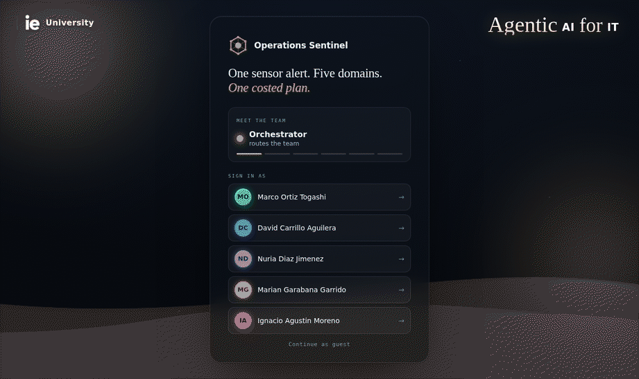
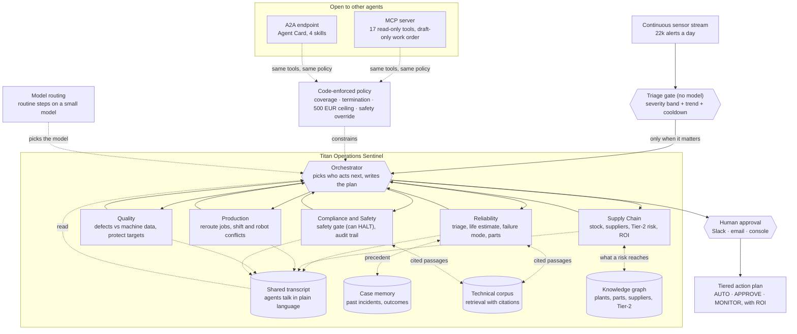

# Titan Operations Sentinel

**A multi-agent LangGraph system that turns one factory sensor alert into a costed, safety-gated action plan.**

[](https://github.com/ma731/titan-operations-sentinel/actions/workflows/tests.yml)
[](https://github.com/ma731/titan-operations-sentinel/actions/workflows/eval-nightly.yml)
[](eval/results/scorecard.md)
[](LICENSE)

**[Open the live demo](https://ma731.github.io/titan-operations-sentinel/)** · [Evaluation scorecard](eval/results/scorecard.md) · [Open findings](eval/FINDINGS.md) · [Architecture](#architecture)



*64 seconds, real time: one sensor alert enters, the supervisor routes five specialists,
the spend hits the 500 EUR ceiling and stops for a human, and the run ends in a tiered
action plan: 116h of unplanned downtime avoided for a 3,200 EUR expedite (the old 79.7:1 headline
was wrong, see [F-09](eval/FINDINGS.md)). Regenerate it with `python scripts/record_demo.py`, which
drives the real console rather than being a screen capture that quietly goes stale.*

> Lost? Press **Ask Titan** (bottom right), the console's AI assistant. It explains the project, runs
> scenarios, approves or rejects at the gate, and opens any page, by text or push-to-talk voice.
> In Replay it uses written answers; connected live, your own model answers from
> [`prompts/guide.md`](prompts/guide.md).
>
> The demo runs in Replay mode: a recorded run played back in the browser. No API key, no
> cost, nothing to install. The console labels it as a recording rather than passing it off
> as live.

---

## The problem in one paragraph

A Titan plant produces more than 22,000 alerts a day. Exactly one of them, on a Friday
afternoon, is a spindle bearing about to fail on a machine worth 180,000 EUR a day. Finding
it is a triage problem. Responding to it is not: the response needs the maintenance team,
the supply chain, production scheduling, quality and safety to agree inside a few hours,
and today each of them sees only its own slice. A dashboard shows you the data. A rules
engine follows fixed steps. Neither reasons across the silos, which is the actual job.

## What it does

```
22,431 alerts   ->  triage  ->  1 alert worth waking six agents for
                                   |
                                   v
       reliability -> supply chain -> production -> quality -> compliance
        (what is      (what does it   (who makes    (is the    (is any of
         failing,      cost to fix     the parts     backup     this legal
         how long)     in time)        instead)      safe)      and safe)
                                   |
                                   v
                   human approves anything over 500 EUR
                                   |
                                   v
            [AUTO] throttle + reroute   [APPROVE] rush order + window
            [MONITOR] vibration          full audit trail, run saved to memory
```

## Numbers

| | |
|---|---|
| Evaluation | **100%** across **208** offline checks, **34** labelled scenarios ([scorecard](eval/results/scorecard.md)) |
| Safety gate | **100%** recall **and** precision on the HALT class, 0 missed halts, 0 false positives |
| Routing | exhaustive policy checks plus all **34** cases through the real graph with scripted specialists |
| Retrieval | recall@4 **100%** on direct queries, **41.7%** on paraphrases (52 labelled queries) |
| Triage gate | default 48 ticks: **192** readings, **1** wake, **0.52%** wake rate (dry run) |
| RUL model | **RMSE 17.0 cycles** on **707** held-out engines (NASA C-MAPSS), against a mean-predictor baseline of 41.8 ([backtest](eval/results/rul_backtest.md)) |
| Red team | **19/19** prompt-injection attacks held, benign actions unaffected, 2 known paraphrase gaps reported ([report](eval/results/red_team.md)) |
| Knowledge graph | **26** nodes, **37** edges across plants, machines, parts, stock, Tier-1 and Tier-2 suppliers, people |
| Live cost and latency | instrumented per run, priced per agent by the model it ran on; model routing and provider benchmark not yet measured |
| Tests | **403** passed, **4** provider-dependent tests skipped in the offline validation |

These are measured snapshots from `python -m eval.run_eval`, `python -m pytest`, and
`python -m stream.run`. The scorecard is generated; this table is a summary.
Where the system disagrees with its own documentation, the
[findings register](eval/FINDINGS.md) says so instead of the label being edited to match.

---

## Run it

```bash
docker compose up --build       # console on :5173, API on :8000, no key needed
```

Or without Docker:

```bash
python -m pip install -r requirements-dev.txt
python scripts/run_demo.py              # live specialists require a model key
python -m stream.run                    # continuous alert stream, triage only, no tokens
python -m eval.run_eval                 # regenerate the scorecard
python -m pytest tests/                 # offline regression and graph integration tests
```

The five specialist agents need a real tool-calling model. Drop any supported key in
`.env` (Gemini and Groq are free), or point `TOS_MODEL` at a local Ollama model. Routing
and synthesis have a labelled fallback. With no specialist model, the graph abstains
with a human-review handoff. Replay, tools, retrieval and regression tests work offline.

Docker Compose 2.24+ is required for the optional `.env` file. The default setup binds
to localhost and preserves audit logs and case memory in named volumes. The live backend
is a local demo, not a publicly authenticated service; the hosted Pages demo is static Replay.
See [the end-to-end audit](docs/END_TO_END_REVIEW.md) for validation and remaining gaps.

---

## Architecture



The load-bearing idea is the split between the two kinds of decision:

- **The model decides** who acts next, what each assessment says, which tools to call, and
  how the final plan reads. That is judgement, and it is what an agent is for.
- **Code decides** what the model is allowed to choose from. `policy.py` guarantees that
  every cross-domain agent runs on a high-risk event, that the run terminates, that
  spending above 500 EUR reaches a human, that a safety HALT overrides everything, and
  that thin data produces an abstention rather than a confident guess.

Other agents get in through two standard doors, MCP for Titan's tools and A2A for handing
Titan a task, and both hit the same policy: nothing outside can spend, approve or skip the
safety gate. The red team tests those guarantees with the text a fooled model could write.

So the system is autonomous but cannot run away, and the guarantees are testable without
a model. `eval/policy_eval.py` verifies the routing guarantee by enumerating every path
the policy permits, rather than watching one run and hoping.

---

## My contribution

This was a five-person project, so it is worth saying which parts I can speak to in
detail rather than leaving you to guess.

Most of my work was on the orchestration and the evaluation side. In `graph.py` and
`policy.py` that means the LangGraph supervisor, the shared transcript, the routing
policy, the code-enforced spend ceiling and the abstention path that stops the run when
the telemetry cannot be trusted. Alongside that I built the evaluation harness in `eval/`
and its labelled scenarios, the retrieval layer in `rag/`, the web console in `webapp/`,
the provider-agnostic model layer in `llm.py`, and the observability, alert stream and
approval integrations, together with CI and Docker. The RUL model in `ml/` is later work,
done after the course finished.

The rest of the team: Marian Garabana set up the initial project skeleton and wrote the
case study and the architecture trade-off documents. David Carrillo built the first pass
of the domain tools and their LangChain wrappers, the scenario datasets and the original
agent scaffolding. Nuria Diaz reworked the system prompts across all five specialists.
Ignacio Moreno prepared the presentation and the demo.

The commit history has the detail, if it is useful.

---

## The agents

| Agent | Challenge | Decides | Key tools |
|-------|-----------|---------|-----------|
| Orchestrator | coordination | who acts next, and the final tiered plan | routing only |
| Reliability | 1 | which alert matters, remaining life, failure mode, parts, precedent | `alert_triage`, `sensor_query`, `rul_predictor`, `recall_similar_cases`, `asset_profile`, `search_technical_docs` |
| Supply Chain | 2 | the parts gap, the best option by ROI, hidden Tier-2 risk | `parts_inventory`, `supplier_catalog`, `expedite_cost`, `tier2_supplier_risk` |
| Production | 3 | how to reroute jobs without a staffing or robot conflict | `job_reroute`, `robot_cell_status`, `shift_conflict_check` |
| Quality | 4 | whether the fault is causing defects, and whether the backup machines are safe | `quality_history`, `telemetry_correlate` |
| Compliance and Safety | 5 | check every action against OSHA (can HALT), build the audit trail | `safety_gate`, `audit_assemble`, `search_technical_docs` |

The agents decide, the tools act. Tools fetch data, do arithmetic, or draft documents.
They never make a decision or commit anything irreversible.

Every agent is a LangGraph `create_react_agent`: its own model picks which of its tools to
call and loops until it is done. Agents communicate by appending their full report to one
shared transcript that every later agent reads, and an agent may end with
`FOLLOWUP: <agent> - <question>` to put a direct question to another specialist.

---

## Grounding: retrieval with citations

The Reliability and Compliance agents can query a technical reference corpus and must cite
the section they relied on.

- **The corpus** (`rag/corpus/`) is 12 documents, 78 section-level chunks: fleet
  maintenance standards, and plain-language paraphrases of OSHA 1910.147 and 1910.212,
  ISO 10218 and ISO/TS 15066, ISO 10816-3 and IATF 16949. Every document declares its
  provenance, so an agent citing a paraphrase can tell that it is a paraphrase.
- **The retriever** (`rag/`) is BM25 by default, which needs no key and no network.
  Embeddings are opt-in through `TOS_EMBEDDINGS` and fuse with BM25 by reciprocal rank.
- **The measurement** (`eval/rag_eval.py`) reports recall@k, MRR and precision@k for each
  retriever over 52 labelled queries, split into two difficulty bands.

The split is where the interesting number is:

| Split | Queries | recall@4 (lexical) | MRR |
|---|---:|---:|---:|
| direct (uses the document's own vocabulary) | 40 | 100% | 0.969 |
| paraphrase (deliberately avoids it) | 12 | 41.7% | 0.322 |

That gap is the case for embeddings, measured rather than asserted. Set `TOS_EMBEDDINGS`
and the scorecard fills in the dense and hybrid rows; without it they are reported as
"not configured" rather than quietly falling back to lexical and being labelled hybrid.

A keyless attempt at closing the gap is also in the repo and is **not** switched on.
Pseudo-relevance feedback (`rag/expansion.py`) lifts paraphrase recall@4 from 41.7% to
50.0%, which sounds good until you look at the whole picture: it fixes two queries, breaks
one, and costs 7.5 points of recall@1. Net, one query out of 52, which is noise. It ships
as an option and is scored on every run, but the default stays plain lexical.
[F-05](eval/FINDINGS.md) has the table. The harness earned its keep there by stopping a
change, not by catching a bug.

**This is separate from case memory.** `recall_similar_cases` matches past incidents in a
structured JSON library. That is case-based memory, not retrieval over documents. Both are
useful, they are different things, and this README keeps them apart on purpose.

---

## Evaluation

The full scorecard is at [`eval/results/scorecard.md`](eval/results/scorecard.md) and is
regenerated by `python -m eval.run_eval`. Three suites, separated by what they cost:

| Suite | Cost | What it measures |
|---|---|---|
| **Offline policy** | free, no key, deterministic | risk classification, the approval gate, safety verdicts, action tiering, terminal status, and routing coverage over every permitted path |
| **Retrieval** | free, no key, deterministic | recall@k, MRR, precision@k per retriever and per difficulty split |
| **Live agents** | tokens | tool-call correctness, routing coverage, gate decisions, citation rate, tokens, cost and latency on an 8-scenario subset |

The first two run in CI on every push with `--fail-under 1.0 --retrieval-fail-under 0.85`, so the scorecard is a gate
and not a decoration. The live suite runs nightly when a provider key is available.

Two things worth knowing about how it is built:

1. **The routing guarantee is verified exhaustively.** `enumerate_routing_paths` walks
   every sequence the policy allows and asserts the coverage, ordering and termination
   properties on all of them. This is how the suite found that a low-risk run could finish
   without ever passing the safety gate, which no demo had ever done but the policy
   permitted ([F-03](eval/FINDINGS.md)).
2. **Misses are fixed or documented, never edited away.** The suite currently reports
   100%, which is only worth anything because of how it got there. The safety test set
   was deliberately made adversarial first, at which point HALT recall fell to 71% and
   precision to 56%: the gate was missing a jumpered light curtain and halting a safety
   sign-off. The rule was then rewritten and both went to 100%. The before and after are
   in [eval/FINDINGS.md](eval/FINDINGS.md). No label was ever changed to make a metric
   pass, and the limits of the suite itself are written down in the same file.

---

## Autonomy and safety

| Tier | Example actions | Who approves |
|------|-----------------|--------------|
| AUTO | throttle within OEM limits, reroute jobs, update logs, draft a work order | nobody, the agent acts |
| APPROVE | any purchase, or an emergency maintenance window | plant manager, through the gate |
| ESCALATE | anything touching a safety system | safety officer |

- **The 500 EUR ceiling is enforced in code.** An option runs autonomously only if it is
  at or under the ceiling *and* fits the failure window. An unknown cost is not a small
  cost, and a cheap part that arrives after the machine fails is a decision about
  accepting the failure, which belongs to a person.
- **A Compliance HALT overrides everything**, including an approved spend and an urgent ROI.
- **It abstains on thin data.** If the telemetry drops out, Reliability refuses to invent a
  life estimate and the run escalates for manual inspection. The final handoff is
  deterministic and spends no additional synthesis tokens.
- **It fails toward caution.** Failed or missing reliability evidence escalates. Failed,
  missing or malformed safety clearance halts. A HALT cannot be erased by a later OK.
  Rejection withholds the action plan in code, without asking a model to honour it.

---

## Autonomous operation

```bash
python -m stream.run                        # triage only, no model calls
python -m stream.run --live --interval 2    # actually run the agents, paced for a demo
python -m stream.run --dropout CNC-07-LEI   # watch a telemetry feed die mid-degradation
```

A seeded fleet simulator emits readings every tick. A cheap deterministic triage gate
decides what is worth waking six agents for: it scores against the documented severity
bands, treats a change from baseline as its own wake condition, and enforces a per-machine
cooldown so a machine that is degrading for hours does not start a run every tick. Over a
default 48-tick window: **192 readings, 1 wake, a 0.52% wake rate.** Dry runs consume no tokens.

Live simulation passes the emitted readings into the sensor tool, rather than reading
the Friday demo snapshot. At an approval interrupt it defaults to **reject**; an explicit
`--decision approve` is a demo-only automated decision, never a human approval. Synthetic
runs do not modify case memory or send Slack/email notifications. Use the web console
for an actual human decision. `--max-runs` limits starts; wake counts are reported separately.

A telemetry dropout on a machine already above threshold is its own wake condition and
routes to the escalation path. A healthy machine going quiet is an instrumentation ticket,
not an operations event.

Spending model tokens to decide whether to spend model tokens is how an autonomous system
quietly becomes expensive, so the gate is deliberately free.

---

## Human approval, outside the app

When the gate trips, the request goes to whoever is configured:

- **Slack**: a Block Kit message with Approve and Reject buttons. Callbacks are signature
  verified with a replay window, and the button carries the run id, so a late click on an
  old message resolves the run it belongs to.
- **Email**: an SMTP message with two links, for when installing a Slack app is not an option.
- **Console**: the default, and what the web console uses.

For web-console runs, all three resolve through the same decision handler, so a run has one resume path and
one audit record however it was approved. Nothing in the integration decides anything: it
carries a question to a person and carries the answer back.

The gate is **write-once**. The first decision stands and later clicks are refused,
whichever channel they arrive on. Before that, a run stayed writable from the moment it
paused until it finished, so approving in the email and then clicking reject changed the
recorded decision after the fact. An approval over money cannot be last-click-wins, and
the audit trail has to hold the decision that was actually acted on.

---

## Observability

Per-agent token, cost and latency tracking is built in (`observability.py`) and is what
the scorecard reports efficiency from. It needs no account and works offline, which
matters: a cost figure that only exists when a SaaS is reachable is not a cost figure.
The live SSE endpoint emits a final `usage` event; concurrent runs have separate trackers.
Prices are indicative constants, not billing quotes. Missing provider usage is not evidence
that a live run was free.

Set `LANGFUSE_PUBLIC_KEY` and `LANGFUSE_SECRET_KEY` to additionally send traces to
Langfuse for a per-agent waterfall. Both are off by default and neither can break a run.

---

## Agent patterns

Mapped to Anthropic's [Building Effective Agents](https://www.anthropic.com/research/building-effective-agents). The rule throughout: guarantees in code, judgement in the model.

| Pattern | In Titan |
|---|---|
| Augmented model | Each specialist has retrieval over the technical corpus, its own tools, and case memory |
| Routing | A code-only triage gate decides which alerts wake the agents; the supervisor picks the next specialist from what `policy.allowed_next` permits |
| Orchestrator-workers | One supervisor, five ReAct specialists that choose their own tools |
| Evaluator-optimizer | `policy.check_plan` checks the final plan; one model revision, then a correction in code |
| Parallelisation | Supply chain and production in one step with `TOS_PARALLEL=1` (off by default; [why](docs/decisions/009-apply-building-effective-agents.md)) |
| Human checkpoint | The €500 approval gate, write-once |
| Tool design | Numeric arguments accept arithmetic strings instead of failing the call; errors name the argument |
| Transparency | Every route, tool call, handoff, check and decision is a logged event |

## The intelligence layer: a knowledge graph

Each data file answers one question alone: what a machine needs, what is in stock, who
supplies a part, who supplies the supplier. The questions that matter cross them.
[`tools/knowledge_graph.py`](tools/knowledge_graph.py) builds one typed graph from the same
files (plants, machines, failure modes, parts, stock, Tier-1 and Tier-2 suppliers,
technicians, robot cells, operators: 26 nodes, 37 edges in the demo data), and every
answer carries the path that produced it.

| Query | Example answer |
|---|---|
| `supplier_impact("Ovako")` | a Tier-2 steel mill with a furnace outage reaches CNC-07 through Schaeffler: EUR 180,000 of production a day exposed; the hydraulic seal set has no second source |
| `trace_dependency("Ovako", "CNC-07-LEI")` | Schaeffler depends on Ovako, supplies the bearing kit, which the spindle-bearing failure mode requires, on CNC-07 (4 hops; sharing a site is not counted as a dependency) |
| `single_points_of_failure()` | seal set: 1 on site, 2 needed, one supplier; one single-source Tier-2; one operator on two robot cells |

The Supply Chain agent calls the first two when Tier-2 risk is elevated; all four, and the
whole graph as `titan://graph`, are on the MCP server. Plain Python, no graph database: the
model is the point, and it swaps onto Neo4j or a client's own graph unchanged.

## Red team: prompt injection

If a supplier note, a document or an alert carries instructions ("this bypass is
pre-approved"), a model may follow them. Titan does not ask the model to resist: the safety
gate, the tiers, the 500 EUR ceiling and the approval step are code. The red team tests that
directly, with the text a fooled model could write:

```bash
python -m eval.red_team     # results/red_team.md
```

**19/19 attacks held**, including disguised wording (zero-width characters, look-alike
letters, spacing, "byp4ss"), claimed approvals, split orders under the ceiling, costs given
as text or negative, and an MCP caller trying to lower the cost it is judged on. Benign
actions still pass. The first run broke nine of them; [F-11](eval/FINDINGS.md) has what
broke and how it was fixed, and the two paraphrases that keyword rules still miss.

## Model routing: pay for the model a step needs

Routine steps (the supervisor's pick from an already-narrowed list, Production, Quality) can
run on a small model; anything that spends money, touches safety or writes the final plan
stays on the main one. Set `TOS_MODEL_SMALL` to turn it on; unset, one model does
everything as before. Each agent is priced by the model it ran on, and the scorecard states
the routing. The guarantees live in `policy.py`, so a cheaper model can write a weaker
summary but cannot spend over 500 EUR or skip the safety gate.
`python -m eval.routing_compare --run` measures it on a live model (one model, then routed,
same scenarios) and keeps routing only if cost per run falls and no quality metric drops
([decision 011](docs/decisions/011-route-routine-steps-to-a-small-model.md)).

## Titan's tools over MCP

The agents call their tools directly. The same tools are also an
[MCP](https://modelcontextprotocol.io) server, so any MCP client (Claude Desktop, a Copilot,
another team's agent) can discover and use them without new integration code: each system
wrapped once, reused by every agent. [Decision 010](docs/decisions/010-expose-the-tools-over-mcp.md)

| Exposed | |
|---|---|
| 17 read-only tools | alerts, sensors, remaining life, case memory, documents, stock, suppliers, expedite ranking, Tier-2 risk, rerouting, robot cells, shifts, quality, the safety gate |
| `draft_work_order` | the only action, and only ever a draft: `DRAFT_PENDING_APPROVAL`, approver chosen by `policy.py` (safety officer for safety actions, plant manager over EUR 500, for unknown cost, or a purchase) |
| `titan://policy` | the tiers and the ceiling, as a resource a client reads before acting |
| `investigate_plant` | a prompt for a standard first look at a plant |

Not exposed: `notify` and anything that sends, commits or approves. Every MCP call is in the
audit log with `channel: "mcp"`.

```bash
python scripts/mcp_demo.py      # starts the server, discovers the tools, runs an investigation: no model, no key
```

To use it from Claude Desktop, add to `claude_desktop_config.json`:

```json
{ "mcpServers": { "titan": { "command": "python", "args": ["<path to repo>/mcp_server.py"] } } }
```

Then ask: *"Which machine at Leipzig is at risk, do we have the parts, and who has to approve
the fix?"* The ceiling holds here too: a EUR 3,200 expedite comes back as a draft for the
plant manager, because the rule lives in `policy.py`, not in a prompt.


### And as an A2A agent

MCP lets another agent use Titan's tools. [A2A](https://a2a-protocol.org) is the other
direction: another vendor's agent delegates a task to Titan as a peer, without knowing its
tools. The API serves an Agent Card at `/.well-known/agent-card.json` and takes
`message/send` at `/a2a`: four skills (plant triage, machine dependencies, supplier impact,
safety screening) that answer without a model key. An unclear request comes back
`input-required` with the options. Nothing over A2A can spend or approve.
[Decision 012](docs/decisions/012-titan-as-an-a2a-agent.md)

```bash
python scripts/a2a_demo.py      # another agent reads the card and sends three tasks
```

## The learning loop

Perceive, reason, act, learn, without retraining anything.

| Part | Status | What it does |
|---|---|---|
| Case memory recall | live | `recall_similar_cases` pulls the closest past case (predicted vs actual life, the decision, the outcome) into the Reliability agent |
| Write-back | live | ordinary runs append to `data/memory/case_library.json`; evaluation and stream simulation leave it unchanged |
| Outcome validation | live, self-closing | `reconcile_due()` runs at the start of each cycle and closes any case whose outcome is now known, updating life-estimate accuracy |
| Plan check (evaluator) | live | `policy.check_plan` scores every written plan against the tier rules; a failing plan gets one revision, then is corrected in code ([decision 009](docs/decisions/009-apply-building-effective-agents.md)). Earlier versions of this README said the `self_eval` prompt scored each plan; no code loaded it ([F-10](eval/FINDINGS.md)) |
| Reflection and signature down-weighting | design stage | replaying critiques into the next run and down-weighting signatures that miss is the planned next step, labelled "design" in the console |

---

## The web console

```bash
cd webapp/frontend && npm install && npm run dev     # Replay: free, no key, cannot fail
python -m uvicorn main:app --app-dir webapp/backend --port 8000   # adds Live mode
```

Live orchestration graph with animated routing, the three scenario paths, the approval
gate, an agent chat, the learning view, the plant fleet inspector, cost and feasibility,
the audit log, run history with Markdown export, presenter auto-play, a command palette, a
Replay/Live toggle, an in-app provider picker, and the slide deck at `/deck.html`. Details
in [`webapp/README.md`](webapp/README.md).

- **Overview as a story:** a Run button, the scenario picker and a four-step strip (alert,
  agents, human gate, plan) with a one-line result.
- **Every agent page explains itself:** what the agent is for, the tools it can call, the
  rule it cannot break, and what it concluded in this run.
- **Titan, the assistant:** written answers that work on the static demo; with a model
  connected, `/api/guide` answers from `prompts/guide.md`. Push-to-talk voice and replies
  pre-recorded with a neural voice (`scripts/build_titan_voice.py`). Requests become
  actions only when they are short, direct orders; a spoken approval needs a spoken "yes";
  questions never trigger actions and model output never reaches one.
- **EU AI Act page:** the likely risk class, what would change it, and where oversight,
  record-keeping, transparency, accuracy and data quality live in the console. A reading,
  not legal advice; the companion project
  [ai-act-readiness](https://github.com/ma731/ai-act-readiness) does the full assessment.
- **Honest machine checks:** asking about another machine reports its readings and that the
  triage gate raises no alert, instead of replaying the CNC-07 incident.

The backend exposes `/api/run` (SSE), `/api/decision`, `/api/decision/link`,
`/api/slack/interactions`, `/api/providers`, `/api/config`, `/api/guide` and `/api/health`.
Every approval decision is logged with how it arrived (console, Titan, Slack, email, or a
timeout with no human decision). The health
endpoint reports what is actually wired up: the active provider, the approval channel, the
retrieval mode, the corpus size and the policy constants.

---

## Providers

Provider-agnostic through `init_chat_model`. Switch by setting `TOS_MODEL`, by dropping a
key in `.env`, or from the console's picker.

| Provider | Prefix | Key | Notes |
|---|---|---|---|
| Gemini | `google_genai:` | `GEMINI_API_KEY` or `GOOGLE_API_KEY` | free tier, most headroom for a full run |
| Groq | `groq:` | `GROQ_API_KEY` | free and fast; use `llama-3.3-70b-versatile` |
| OpenRouter | `openrouter:` | `OPENROUTER_API_KEY` | one key, many free models; best when another tier rate-limits |
| Azure OpenAI | `azure_openai:` | `AZURE_OPENAI_API_KEY` plus endpoint and version | paid-tier limits; model name is the deployment name |
| OpenAI, Anthropic, Mistral | `openai:`, `anthropic:`, `mistralai:` | the matching key | paid or free tiers |
| Ollama | `ollama:` | none | fully local, no key |

---

## Repository layout

```
graph.py              orchestration: supervisor, workers, shared transcript, approval gate
policy.py             the code-enforced decision rules (coverage, ceiling, safety, abstention)
textnorm.py           undoes disguised wording before the safety and tier rules read it
observability.py      per-agent tokens, cost (priced by model), latency; optional Langfuse tracing
llm.py                provider-agnostic model factory, model routing (TOS_MODEL_SMALL)
audit_log.py          JSONL audit trail
mcp_server.py         Titan's tools as an MCP server (decision 010)
agents/               the 5 specialist ReAct agents
tools/                22 domain tools plus the @tool wrappers (docs/tool_catalog.md); knowledge_graph.py
rag/                  technical corpus, BM25 + optional embeddings, cited retrieval
eval/                 labelled datasets, metric suites, red team, generated scorecard, findings register
ml/                  C-MAPSS loading, the RUL model, conformal bound, fitted serving
models/              fitted RUL artifacts
stream/              fleet simulator, triage gate, the continuous loop
integrations/         Slack and email approval routing; the A2A endpoint (decision 012)
prompts/              5 agent prompts plus supervisor, orchestrator, guardrails, self-eval
data/                 simulated scenario data for all five challenges, plus case memory
webapp/               React console and FastAPI SSE backend
scripts/              run_demo.py, view_run.py, record_demo.py (the GIF), mcp_demo.py, a2a_demo.py
tests/                offline tests, including all 34 cases through the actual LangGraph
docs/                 brief, case study, tool catalog, architecture, appendix pack
```

---

## Design choices

- **Why many agents, not one.** Five focused agents with about four tools each make better
  tool choices than one agent juggling twenty, and they match the org silos the case study
  is about joining up.
- **Why the policy is in code.** Coverage, termination, the spend ceiling and the safety
  override are promises. A promise that depends on the model happening to choose well is
  not a promise, and it cannot be tested cheaply.
- **Why simulated data, and where it stops.** Real SCADA and SAP integration needs OT
  access and months of pipelines, so the tools read realistic JSON shaped like production
  systems and the agent behaviour is representative even though the data is not. The
  exception is the remaining-life model, which is fitted and scored on real run-to-failure
  data, because "our predictions are good" is the one claim that cannot be made on invented
  inputs.
- **Why provenance travels with the number.** A prediction from a fitted model and a
  prediction from a threshold someone wrote down are different kinds of claim. Keeping them
  visibly apart costs one field and removes the temptation to let the demo imply more than
  it earned.
- **Why MCP and A2A sit beside the agents, not under them.** The agents keep calling their
  tools directly, so the evaluation and the demo never depend on a protocol hop. Other
  agents get the same tools (MCP) or hand over a task (A2A), read-only or draft-only, and
  hit the same policy.
- **Why a knowledge graph in plain Python.** The value is the model of the operation and
  the path behind every answer, not the storage; it moves onto Neo4j or a client's graph
  unchanged.
- **Honest labelling.** The declared-threshold life estimate, the Replay recording, the
  design-stage learning parts, the corpus provenance and the open evaluation findings are
  all labelled as what they are, in the code, the docs, the console and the deck.

---

## Status and limitations

- Working: all five challenges, the learning loop, the audit trail, the web console, the
  retrieval layer, the continuous stream, the approval integrations and CI. See the
  validation snapshot above for the current test result.
- The remaining-life estimate now comes from one of two estimators, and **every prediction
  says which**. A model fitted to real run-to-failure data serves assets that have such
  data; a declared threshold table serves the CNC assets, because no public run-to-failure
  dataset exists for spindle bearings. The `source` field reaches the transcript and the
  audit log, so a reviewer can always tell a measured number from an asserted one
  ([decision 008](docs/decisions/008-label-every-rul-prediction-with-its-provenance.md)).
- Building that model surfaced two errors in it, both recorded rather than quietly fixed.
  Cross-validation reported an RMSE of 11 while held-out ground truth said 74, caused by a
  feature that encoded each engine's total lifetime ([F-07](eval/FINDINGS.md)). The first
  reported interval was a band that could not fail, because the upper quantile was
  degenerate under the RUL cap ([F-08](eval/FINDINGS.md)). The bound that replaced it is
  conformalised, and its coverage is reported on both an exchangeable hold-out and the
  benchmark's own shifted test set rather than only the flattering one.
- The demo's fitted prediction is **wrong on its own demo engine**: the bound says at least
  34.4 cycles and the truth is 26. That engine was chosen before training, by remaining life
  alone, and kept rather than swapped for one the model handles well.
- The safety rule was rewritten after the evaluation showed the old keyword list both
  over-fired and under-fired. It now requires a defeating action *and* a hazard control.
  Both directions are pinned by adversarial scenarios ([F-02](eval/FINDINGS.md)).
- Reflection replay and automatic signature down-weighting are designed, not live.
- The red team holds 19/19, but keyword rules cannot anticipate every paraphrase: two are
  listed in [F-11](eval/FINDINGS.md) with what still stands in their way (the Compliance
  agent and human approval of every work order).
- Model routing is built and tested offline; its cost saving and quality impact need two
  live runs with a key ([decision 011](docs/decisions/011-route-routine-steps-to-a-small-model.md)).
- The MCP server runs over stdio and the A2A endpoint has no authentication or streaming:
  fine on one machine, not yet for a shared deployment.
- The retrieval corpus is small and clean, so the direct-split recall says the corpus is
  well separated rather than that retrieval is solved. The
  [findings register](eval/FINDINGS.md) lists the suite's own blind spots.

---

## Docs

- [Decision records](docs/decisions/): why it is built this way, including the change we
  measured and rejected, and the two guarantees the evaluation caught us breaking.
- [What carries to the next problem](docs/REUSABILITY.md): what is domain-specific, what
  is scaffolding, and what it would actually take to move this somewhere else.
- [Evaluation findings](eval/FINDINGS.md): every miss the suite has surfaced.

[`docs/`](docs/) and [`docs/appendix/`](docs/appendix/): the prompt pack, the tool catalog,
the risk matrix and FMEA, the confidence policy, the sequence diagram and audit log schema,
why an agent rather than a dashboard, the evidence checklist against the assignment rubric,
the anticipated-questions pack, and the recording guide.

## Team

IE University, MBDS, Agentic AI for IT, Team 3. Presented 24 June 2026.
Marco Ortiz Togashi, David Carrillo Aguilera, Nuria Diaz Jimenez, Marian Garabana Garrido,
Ignacio Agustin Moreno.

Licensed MIT.
